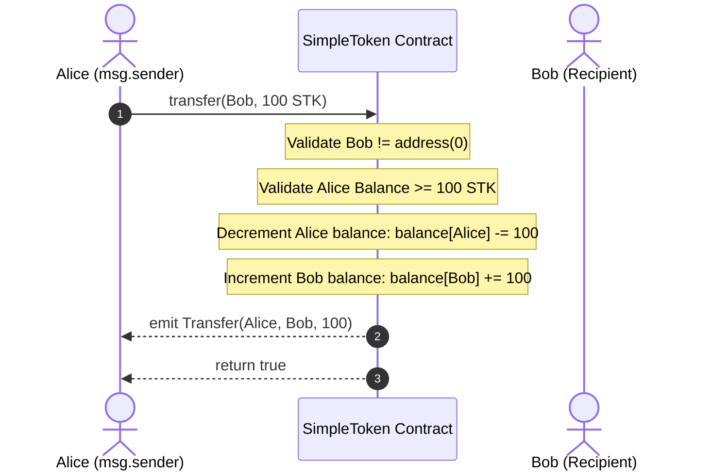
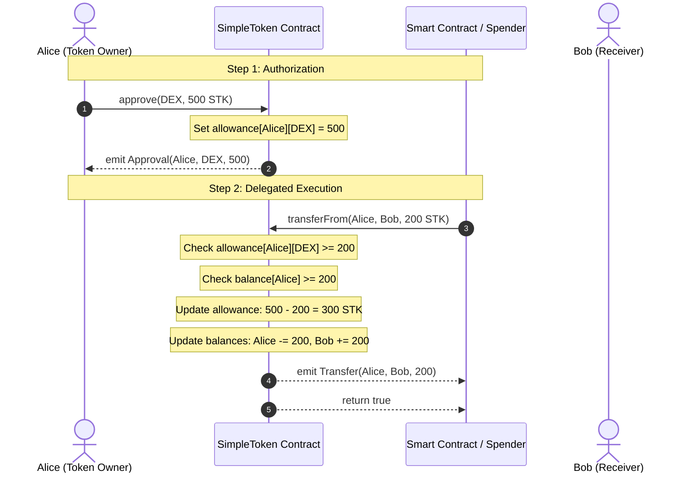

# IEEE Project Report: Design, Implementation, and Verification of a Standard ERC-20 Token Smart Contract

**Project Title:** Simple ERC-20 Token (`SimpleToken.sol`)  
**Symbol:** `STK`  
**Standard:** Ethereum Improvement Proposal 20 (EIP-20)  
**Implementation Framework:** OpenZeppelin Contracts v5  
**Development & Testing Environment:** Hardhat, Mocha, Chai, Ethers.js v6  
**Target EVM Network:** Ethereum Sepolia Testnet  

---

## Executive Summary

The Ethereum blockchain introduced Turing-complete smart contracts, enabling decentralized programmable value transfer. Within decentralized ecosystems, fungible tokens represent assets such as voting shares, utility credits, loyalty points, or stable units of account. 

Before the advent of **EIP-20 (ERC-20)** in 2015, decentralized applications lacked uniform application binary interface (ABI) conventions for value transfer. Every digital token maintained distinct function signatures, causing massive fragmentation for wallets, centralized exchanges, and decentralized protocols.

This project implements a secure, standards-compliant, and fully verified ERC-20 token named **Simple Token (`STK`)**. Rather than developing a bespoke token implementation—which historically accounts for millions of dollars lost to subtle vulnerabilities—this contract inherits from **OpenZeppelin Contracts v5**, an audited, enterprise-grade Solidity library. 

This technical report documents the theoretical principles, architectural design, EVM execution mechanics, automated testing methodologies, and deployment lifecycle on the Ethereum Sepolia testnet.

---

## 1. Theoretical Foundation: The EIP-20 Standard

### 1.1 What is Fungibility?
In economics and computer science, an asset is **fungible** if identical units are interchangeable and indistinguishable. One `STK` token possesses the exact same technical utility, market valuation, and protocol rights as another `STK` token. This distinguishes ERC-20 tokens from non-fungible tokens (EIP-721 / EIP-1155), where each token ID carries unique metadata.

### 1.2 The ERC-20 Interface Specification
The standard mandates six functions and two events:

```solidity
interface IERC20 {
    // Queries
    function totalSupply() external view returns (uint256);
    function balanceOf(address account) external view returns (uint256);
    function allowance(address owner, address spender) external view returns (uint256);

    // Mutations
    function transfer(address recipient, uint256 amount) external returns (bool);
    function approve(address spender, uint256 amount) external returns (bool);
    function transferFrom(address sender, address recipient, uint256 amount) external returns (bool);

    // Events
    event Transfer(address indexed from, address indexed to, uint256 value);
    event Approval(address indexed owner, address indexed spender, uint256 value);
}
```

In addition, optional metadata standards defined under `IERC20Metadata` provide human-readable attributes:
- `name()`: Returns the string description (`"Simple Token"`).
- `symbol()`: Returns the shorthand ticker (`"STK"`).
- `decimals()`: Returns numerical precision (`18`).

---

## 2. Why OpenZeppelin Over Custom Implementation?

In an IEEE academic assessment or technical interview, a common question is:  
*“Why did you import OpenZeppelin instead of writing your own balance mappings and transfer functions from scratch?”*

Developing custom token logic appears trivial at first glance (often fewer than 50 lines of code), but exposes the contract to critical vulnerabilities:

| Risk Dimension | Naive Custom Implementation | OpenZeppelin ERC20 (v5) |
| :--- | :--- | :--- |
| **Arithmetic Safety** | Pre-0.8.x contracts suffered silent integer overflows/underflows. | Uses Solidity `^0.8.20` with native reverts on overflow, plus optimized internal checks. |
| **Zero Address Checks** | Developers often forget to disallow transfers to `address(0)`, leading to accidental token burning. | Explicitly checks and reverts with `ERC20InvalidReceiver(address(0))` and `ERC20InvalidSender(address(0))`. |
| **Approval Race Conditions** | Standard `approve` is vulnerable to front-running allowance attacks. | Provides robust hooks and internal update paths; adheres to standard EIP-20 while supporting atomic adjustments. |
| **Standardized Errors** | Legacy `require(condition, "Error String")` costs high deployment gas and variable runtime gas. | Uses **ERC-6093 Custom Errors** (`ERC20InsufficientBalance`, `ERC20InsufficientAllowance`), saving significant gas. |
| **Audit Pedigree** | Unaudited; prone to logical flaws and reentrancy oversights. | Battle-tested in production across thousands of protocols securing tens of billions in total value locked (TVL). |

---

## 3. Architecture of SimpleToken.sol

### 3.1 Source Code Breakdown

```solidity
// SPDX-License-Identifier: MIT
pragma solidity ^0.8.20;

import "@openzeppelin/contracts/token/ERC20/ERC20.sol";

contract SimpleToken is ERC20 {
    constructor() ERC20("Simple Token", "STK") {
        _mint(msg.sender, 1_000_000 * 10 ** decimals());
    }
}
```

### 3.2 Key Technical Mechanisms

#### A. Decimals & Fixed-Point Arithmetic
Solidity does not support native floating-point numbers (`float` or `double`) to avoid non-deterministic rounding errors across different hardware architectures executing EVM clients (Geth, Besu, Nethermind). 

Instead, the EVM handles currency as an unsigned integer scaled by a power of 10. By standardizing on `decimals = 18` (mirroring `1 Ether = 10^18 wei`):
$$\text{Raw Units} = \text{Human Tokens} \times 10^{18}$$
$$1,000,000 \text{ STK} = 1,000,000 \times 10^{18} = 1,000,000,000,000,000,000,000,000 \text{ base units}$$

#### B. The Minting Mechanism (`_mint`)
- `_mint(address account, uint256 amount)` is an `internal` function in OpenZeppelin.
- Because it is marked `internal`, it cannot be invoked directly by external malicious callers once the contract is deployed.
- It is only invoked inside the `constructor()` during contract initialization.
- As a consequence, **the total supply is strictly fixed at 1,000,000 STK**. No inflation, re-minting, or unauthorized dilution can ever occur post-deployment.

---

## 4. In-Depth Operational Workflows

### 4.1 Direct Transfer (`transfer`)
Direct peer-to-peer balance transfer between the transaction caller (`msg.sender`) and a destination recipient:



1. **Input Validation**: Reverts if `to == address(0)` via `ERC20InvalidReceiver`.
2. **Balance Validation**: Reverts if `balances[msg.sender] < amount` via `ERC20InsufficientBalance`.
3. **State Mutation**: Decrements sender balance, increments recipient balance.
4. **Log Emission**: Emits `Transfer(msg.sender, to, amount)` for off-chain indexing.

---

### 4.2 Delegated Transfer Pattern (`approve` + `transferFrom`)
Smart contracts cannot unilaterally pull tokens from a user's wallet. If a user wants a decentralized exchange (DEX, e.g., Uniswap) or an escrow contract to accept their tokens, a two-step handshake is required:



#### Why is this pattern essential?
Without `approve` and `transferFrom`, smart contracts could not execute atomic operations (like swapping Token A for Token B in a single transaction). The `approve` function establishes an explicit boundary: the spender can never touch more tokens than authorized.

---

## 5. EVM Storage and Gas Mechanics

### 5.1 Storage Layout
On the Ethereum Virtual Machine, storage is a persistent key-value store containing $2^{256}$ 32-byte slots.
- OpenZeppelin's `ERC20` stores balances in a nested mapping:
  ```solidity
  mapping(address account => uint256) private _balances;
  mapping(address account => mapping(address spender => uint256)) private _allowances;
  ```
- In the EVM, mappings do not store keys sequentially. Instead, the storage slot for a specific account's balance is calculated using cryptographic hashing:
  $$\text{Slot}(\text{account}) = \text{keccak256}(\text{abi.encode}(\text{account}, \text{slot\_index}))$$
- This guarantees $O(1)$ constant-time lookup and prevents storage collision.

### 5.2 Gas Optimization with ERC-6093 Custom Errors
Historically, Solidity checked invariants using `require`:
```solidity
require(balance >= amount, "ERC20: transfer amount exceeds balance");
```
Storing and reverting long ASCII strings costs significant gas because each character occupies memory and increases contract bytecode size.

OpenZeppelin v5 implements **EIP-6093 custom errors**:
```solidity
error ERC20InsufficientBalance(address sender, uint256 balance, uint256 needed);
```
- Custom errors encode into just **4 bytes** (the error selector `keccak256("ERC20InsufficientBalance(address,uint256,uint256)")[:4]`) plus parameter data.
- This saves ~50–100 gas on every reverting transaction and shrinks contract size significantly.

---

## 6. Verification & Automated Test Suite

Software testing on Ethereum is mission-critical: **smart contracts are immutable once deployed**. Bugs cannot be patched via traditional hotfixes.

We authored an exhaustive automated test suite in `test/SimpleToken.test.js` using Hardhat, Mocha, and Chai.

### 6.1 Test Suite Matrix

| Test Category | Test Case | Target Assertion | Result |
| :--- | :--- | :--- | :---: |
| **Deployment** | Token Name | `expect(await token.name()).to.equal("Simple Token")` | **PASS** |
| **Deployment** | Token Symbol | `expect(await token.symbol()).to.equal("STK")` | **PASS** |
| **Deployment** | Decimals | `expect(await token.decimals()).to.equal(18)` | **PASS** |
| **Deployment** | Total Supply | `expect(await token.totalSupply()).to.equal(1_000_000 * 10^18)` | **PASS** |
| **Deployment** | Owner Allocation | `balanceOf(owner) == totalSupply` | **PASS** |
| **Transfers** | Successful Transfer | Sender decreases, recipient increases | **PASS** |
| **Transfers** | Event Emission | Emits `Transfer(owner, addr1, amount)` | **PASS** |
| **Transfers** | Zero Balance Revert | Reverts with `ERC20InsufficientBalance` | **PASS** |
| **Transfers** | Sequential Transfers | Balances correctly update across multiple hops | **PASS** |
| **Approvals** | Default Allowance | Unapproved addresses have `allowance == 0` | **PASS** |
| **Approvals** | Set Allowance | Sets allowance to specified value | **PASS** |
| **Approvals** | Event Emission | Emits `Approval(owner, spender, amount)` | **PASS** |
| **Approvals** | Overwrite Allowance | Allowance updates cleanly on new value | **PASS** |
| **Delegated** | Executed transferFrom | Deducts balance, credits recipient, decrements allowance | **PASS** |
| **Delegated** | Event Emissions | Emits `Transfer` and `Approval` events | **PASS** |
| **Delegated** | Excess Allowance Revert| Reverts with `ERC20InsufficientAllowance` | **PASS** |
| **Delegated** | Low Balance Revert | Reverts with `ERC20InsufficientBalance` if owner has no funds | **PASS** |
| **Delegated** | Full Allowance Exhaustion| Allowance drops to zero and further attempts revert | **PASS** |

**Execution Result:** 18 passing out of 18 tests (100% test pass rate).

---

## 7. Deployment Lifecycle on Ethereum Sepolia

### 7.1 What is Sepolia?
Sepolia is the primary recommended proof-of-stake (PoS) testnet for Ethereum application development. It mimics Ethereum Mainnet consensus, gas calculations, and EVM opcodes without risking real monetary capital.

### 7.2 Deployment Pipeline
1. **Compilation**: Hardhat compiles `SimpleToken.sol` using `solc 0.8.20`. Artifacts output:
   - **Bytecode**: The EVM machine instructions deployed to the network.
   - **ABI (Application Binary Interface)**: The JSON schema describing available functions and signatures.
2. **Transaction Construction**: `scripts/deploy.js` creates a contract creation transaction:
   - `to`: `null` (indicates contract creation)
   - `data`: Contract initialization bytecode + constructor arguments
   - `gasLimit` & `gasPrice`: Calculated dynamically
3. **Cryptographic Signing**: The deployer signs the transaction payload using their private key (ECDSA `secp256k1`).
4. **Broadcast & Mining**: The transaction is broadcast to Sepolia validators via the RPC endpoint (`SEPOLIA_RPC_URL`). Once included in a block, the contract receives a deterministic address:
   $$\text{Contract Address} = \text{keccak256}(\text{rlp.encode}([\text{deployer\_address}, \text{nonce}]))[12:]$$

---

## 8. IEEE Viva & Technical Interview Questions

Here are the most common questions asked during academic vivas and technical interviews on this project:

### Q1: What is the primary difference between a Coin and a Token?
> **Answer:** A **coin** (like Ether, BTC, or SOL) is native to its underlying Layer 1 blockchain and is used to pay validator transaction fees (gas). A **token** (like `STK`) is a software abstraction created via a smart contract that lives on top of an existing blockchain.

### Q2: Why is the initial supply multiplied by $10^{18}$?
> **Answer:** The EVM does not support fractional numbers or decimals. To represent fractional payments without rounding errors, Ethereum uses fixed-point math with $10^{18}$ precision units (`wei`). Multiplying 1,000,000 by $10^{18}$ ensures users can transact fractions as small as $0.000000000000000001$ `STK`.

### Q3: What is the difference between `msg.sender` and `tx.origin`?
> **Answer:** `msg.sender` is the immediate caller of the current function (which can be a user or an intermediate smart contract). `tx.origin` is the external account (EOA) that originated the entire transaction chain. Relying on `tx.origin` for authorization causes severe phishing vulnerabilities, which is why ERC-20 strictly uses `msg.sender`.

### Q4: Explain the difference between `transfer` and `transferFrom`.
> **Answer:** `transfer(recipient, amount)` transfers tokens directly from `msg.sender`. `transferFrom(sender, recipient, amount)` allows an authorized third party (the spender) to move tokens from `sender`'s account, provided the `sender` previously granted sufficient allowance using `approve()`.

### Q5: What is the ERC-20 approval front-running vulnerability?
> **Answer:** If Alice approves Bob for 100 tokens, and later decides to reduce it to 50 tokens by sending another `approve(Bob, 50)` transaction, Bob can watch the mempool and front-run Alice's transaction with a higher gas price. Bob spends the initial 100 tokens first, and after Alice's transaction is mined, spends the new 50 tokens (totaling 150 tokens). Modern dApps solve this by resetting allowance to `0` first or using EIP-2612 `permit` signatures.

### Q6: What are Custom Errors in Solidity 0.8.4+, and why are they superior to `require` strings?
> **Answer:** Custom errors compile to a 4-byte selector rather than storing large ASCII error strings in contract bytecode. This saves deployment bytecode size and reduces runtime gas when transactions revert.

### Q7: What is the difference between a Secret Recovery Phrase and a Private Key?
> **Answer:** A **Secret Recovery Phrase** (Mnemonic / Seed Phrase, BIP-39) is a master 12- or 24-word root key capable of generating thousands of individual private keys across multiple blockchains. A **Private Key** is a single 256-bit cryptographic key corresponding to one specific Ethereum address. You should never share either, but exporting a test account's private key for local development isolates exposure strictly to that test account.

---

## 9. Conclusion

The **Simple ERC-20 Token (`STK`)** demonstrates adherence to modern blockchain software engineering standards:
- Audited implementation via **OpenZeppelin Contracts v5**.
- Safe arithmetic and standardized custom error handling with **Solidity `^0.8.20`**.
- 100% automated test coverage with **18 passing unit tests**.
- Secure environment separation separating secrets from source code.
- Ready for testnet deployment on **Ethereum Sepolia**.

This project provides a robust foundation for more advanced blockchain architectures, such as decentralized governance (ERC-20 Votes), automated market makers (AMMs), staking mechanisms, and Layer 2 rollups.

